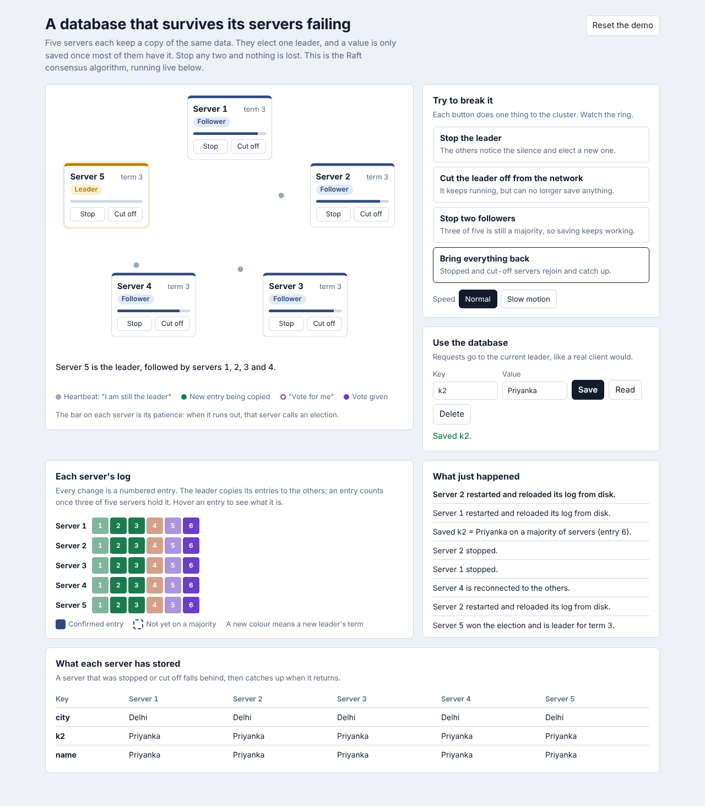

# RaftKV

A key-value store replicated across several servers with the Raft consensus protocol.
A write is acknowledged only after a majority of servers have it, so the data survives
any minority of them crashing.

**Live demo:** _add your link here_

The demo page runs a five-server cluster you can break: save a value, stop the leader,
and watch the others elect a new one without losing anything.

## Files

- `kv_store.py`  the state machine: put / get / delete on a dict
- `raft.py`      the protocol for one node: election, log replication, commit, persistence
- `server.py`    puts a node on HTTP (FastAPI) and ticks its clock
- `demo.py`      the visual demo: five nodes in one process with a simulated network
- `test_raft.py` protocol tests on a simulated network (crashes, partitions, message loss)
- `test_server.py` three real processes: write, kill the leader, read, restart it
- `test_demo.py` the demo cluster's stop, restart and cut-off controls

## See it working

    pip install -r requirements.txt
    uvicorn demo:app

Open http://localhost:8000. `demo.py` uses the same `RaftNode` as the real server; only the
network is replaced by an in-memory queue so the page can stop servers and cut them off.

To host it, push this folder to GitHub and create a Render Blueprint from the repo
(`render.yaml` is included). It needs no database and no keys.

## Run a real 3-node cluster

Three separate processes that talk over HTTP. In three terminals:

    python server.py --id 1 --port 8001 --peers 2=http://127.0.0.1:8002,3=http://127.0.0.1:8003
    python server.py --id 2 --port 8002 --peers 1=http://127.0.0.1:8001,3=http://127.0.0.1:8003
    python server.py --id 3 --port 8003 --peers 1=http://127.0.0.1:8001,2=http://127.0.0.1:8002

Then, against any node (`-L` follows the redirect to the leader):

    curl -L -X PUT http://127.0.0.1:8002/kv/name -H "content-type: application/json" -d "{\"value\": \"Priyanka\"}"
    curl -L http://127.0.0.1:8003/kv/name
    curl http://127.0.0.1:8001/status

Stop the leader's terminal with Ctrl+C: within a second another node takes over and the
key is still there. Start it again and it rejoins as a follower and catches up.

## Tests

    pytest -q

## How it works

`RaftNode` does no I/O. The caller calls `tick()` on a timer and `handle(message)` for each
incoming message, and sends whatever messages they return. The tests and the demo drive it
with a fake network; `server.py` drives it with HTTP and a 50 ms timer.

- A follower that hears nothing for 10-20 ticks (random, so nodes rarely collide) starts an election.
- A node votes once per term, and only for a candidate whose log is at least as up to date as its own.
- The leader appends client commands to its log and sends them to followers. An entry is committed
  once a majority has it, then applied to the key-value store.
- A follower whose log disagrees with the leader's deletes the conflicting entries and takes the leader's.
- Term, vote and log are written to disk (fsync, atomic rename) before any reply.
- Reads go through the log as well, so a leader that has been cut off cannot return stale data.

## Not implemented

- Log compaction / snapshots: the log grows forever and is rewritten in full on every change.
- Cluster membership changes: the node list is fixed at start-up.
- Duplicate detection: a client that retries a write after a timeout may apply it twice.
